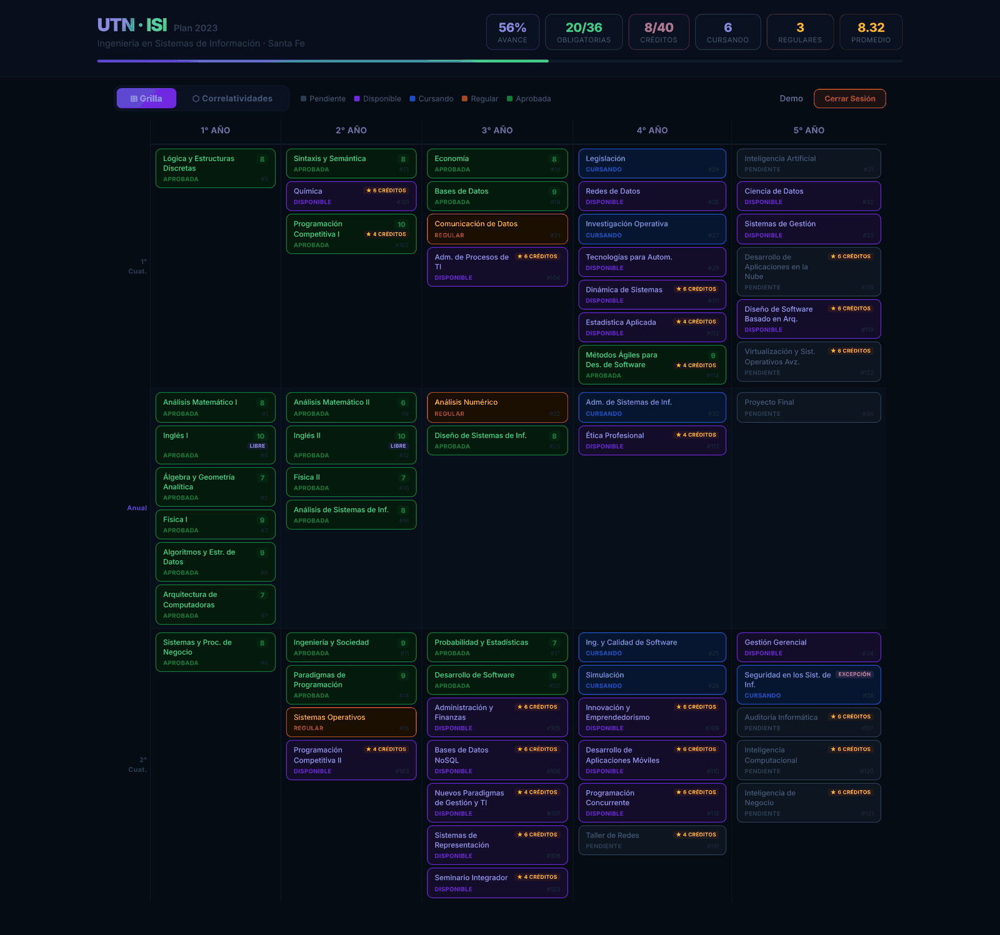
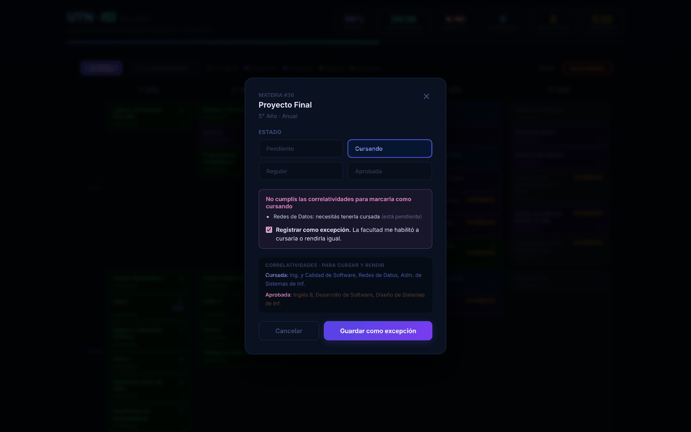
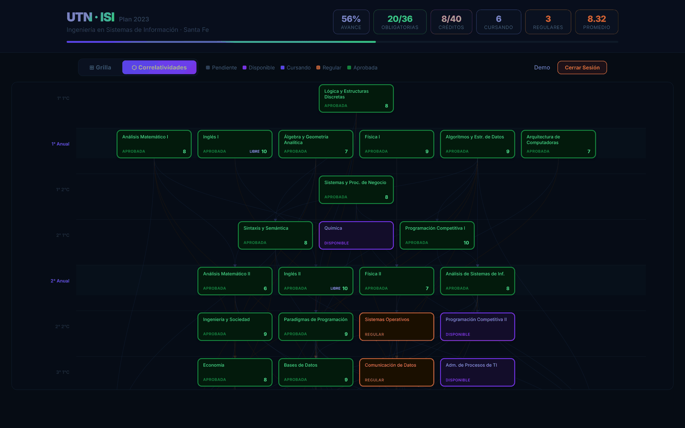
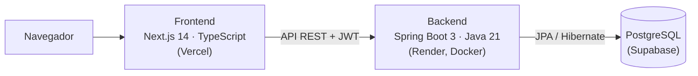

<div align="center">


# UTN Tracker

**Tu plan de estudios en un solo lugar.**
Aplicación web para que estudiantes de Ingeniería en Sistemas de Información de la UTN Facultad Regional Santa Fe (Plan 2023) registren su avance en la carrera, materia por materia.

[**Abrir la app →**](https://utntracker.vercel.app)


</div>

> El backend corre en el plan gratuito de Render: si estuvo un rato sin uso, el primer ingreso puede tardar hasta un minuto en responder.



## ¿Por qué?

Para saber qué materias podés cursar hay que cruzar a mano la tabla de correlatividades del plan con lo que ya regularizaste y aprobaste. UTN Tracker hace ese cruce: cargás el estado de cada materia y la app te muestra en qué punto de la carrera estás y qué tenés habilitado.

## Funcionalidades

- **Grilla por año y cuatrimestre** con las 36 materias obligatorias del Plan 2023 y las electivas, cada una con su estado: pendiente, disponible, cursando, regular o aprobada.
- **Materias disponibles calculadas automáticamente** a partir de las correlatividades: una materia se marca como disponible cuando tenés cursadas y aprobadas las que pide el plan.
- **Excepciones a las correlatividades.** Si la facultad te habilitó a cursar o rendir una materia sin cumplir los requisitos, la app te muestra qué te falta y te deja registrarla igual, con la marca *Excepción*.
- **Grafo interactivo de correlatividades:** al pasar el mouse por una materia se resaltan las que necesita y las que habilita.
- **Panel de progreso:** porcentaje de avance, obligatorias aprobadas, créditos de electivas, materias en curso y regulares, y promedio.
- **Cuentas de usuario** con registro e inicio de sesión con email y contraseña. Al registrarte, el plan completo ya viene cargado.

<table>
  <tr>
    <td width="50%"></td>
    <td width="50%"></td>
  </tr>
  <tr>
    <td align="center"><sub>Registro de una excepción a las correlatividades</sub></td>
    <td align="center"><sub>Grafo de correlatividades</sub></td>
  </tr>
</table>

<sub>Las capturas usan datos de ejemplo.</sub>

## Correlatividades

La app sigue la tabla oficial del Plan 2023, donde los requisitos son los mismos **para cursar y para rendir**:

| Columna del plan | Qué exige | Estados que la cumplen |
|---|---|---|
| Cursada | Tener la correlativa regularizada | Cursando, Regular o Aprobada |
| Aprobada | Tener la correlativa aprobada | Aprobada |

Por ejemplo, para cursar o rendir Física II alcanza con tener cursadas Análisis Matemático I y Física I.

## Arquitectura



| Capa | Tecnologías |
|---|---|
| Frontend | Next.js 14 (App Router), React, TypeScript; grafo dibujado con SVG propio |
| Backend | Java 21, Spring Boot 3, Spring Security con JWT, Spring Data JPA, Lombok |
| Base de datos | PostgreSQL |
| Tests | JUnit 5 y Mockito |
| Infraestructura | Docker, Vercel, Render, Supabase |

### Algunas decisiones técnicas

- **Autenticación sin estado** con JWT: el backend no guarda sesiones y cada pedido viaja con su token.
- **Registro transaccional y en una sola consulta.** Al crear la cuenta, el estado inicial de todas las materias se inserta con un único `INSERT … SELECT`, dentro de la misma transacción que el usuario: o se guarda todo, o nada.
- **Correlatividades de solo lectura.** Las dos relaciones de `Materia` con la tabla `correlatividad` están marcadas como `@Immutable`, así Hibernate nunca reescribe los datos del plan.
- **Capas separadas:** Controller → Service → Repository, con DTOs para no exponer las entidades.

## API

Todos los endpoints, salvo los de `/api/auth`, requieren el encabezado `Authorization: Bearer <token>`.

| Método | Endpoint | Descripción |
|---|---|---|
| `POST` | `/api/auth/register` | Crea la cuenta e inicializa el plan. Devuelve un JWT. |
| `POST` | `/api/auth/login` | Inicia sesión. Devuelve un JWT. |
| `GET` | `/api/materias` | Materias del plan con el estado del usuario y sus correlativas. |
| `PUT` | `/api/materias/{id}/estado` | Actualiza estado, nota y excepción de una materia. |
| `GET` | `/api/progreso` | Estadísticas de avance del usuario. |

## Correr el proyecto localmente

**Requisitos:** Java 21, Maven, Node.js 18 o superior, y una base PostgreSQL (local o en la nube).

### 1. Base de datos

1. Creá una base vacía en PostgreSQL, por ejemplo `utn_tracker`.
2. Al levantar el backend por primera vez, Hibernate crea las tablas (`spring.jpa.hibernate.ddl-auto=update`).
3. Cargá el plan de estudios ejecutando [`backend/src/main/resources/db/data.sql`](backend/src/main/resources/db/data.sql).

> `data.sql` arranca borrando todos los datos y crea un usuario de prueba. Usalo solo en una base nueva, nunca en producción.

### 2. Backend

```bash
cd backend
cp .env.example .env        # completá la conexión a la base y el JWT_SECRET
mvn spring-boot:run
```

| Variable | Ejemplo |
|---|---|
| `DATABASE_URL` | `jdbc:postgresql://localhost:5432/utn_tracker` |
| `DATABASE_USER` | `postgres` |
| `DATABASE_PASSWORD` | `tu_contraseña` |
| `JWT_SECRET` | clave en Base64, por ejemplo la salida de `openssl rand -base64 32` |
| `CORS_ALLOWED_ORIGINS` | opcional, por defecto `http://localhost:3000` |

El backend queda en `http://localhost:8080`. En producción no hay `.env`: las mismas variables se definen en el entorno del servidor. También se puede construir la imagen con el [`Dockerfile`](backend/Dockerfile).

### 3. Frontend

```bash
cd frontend
cp .env.local.example .env.local   # NEXT_PUBLIC_API_URL: URL del backend
npm install
npm run dev
```

La app queda en `http://localhost:3000`.

### Tests

```bash
cd backend
mvn test
```

## Estructura del repositorio

```
utn_tracker/
├── backend/                  API REST en Spring Boot
│   ├── Dockerfile
│   └── src/
│       ├── main/java/…       config · controller · domain · dto · repository · service
│       ├── main/resources/   application.properties · db/data.sql
│       └── test/java/…       tests unitarios con Mockito
├── frontend/                 App en Next.js
│   └── src/
│       ├── app/              páginas: login · register · grilla · grafo
│       ├── components/       grilla, grafo, tarjetas, modal de edición, panel de progreso
│       ├── context/          sesión del usuario
│       ├── hooks/            carga y actualización de materias
│       ├── lib/api.ts        cliente de la API
│       └── types/            tipos compartidos
└── docs/screenshots/         capturas del README
```

## Próximos pasos

- Tests de integración de la API.
- Soporte para otras carreras y planes de estudio.

## Autora

**Julia Pombo Ruiz**, estudiante de Ingeniería en Sistemas de Información en la UTN FRSF.
[LinkedIn](https://www.linkedin.com/in/juliapombo) · [GitHub](https://github.com/juliapomboruiz)
